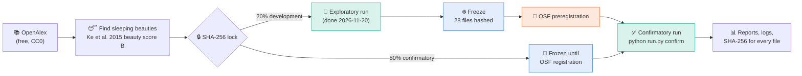
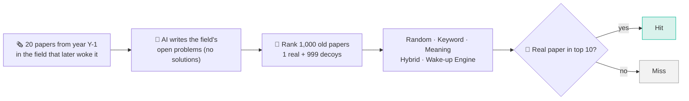
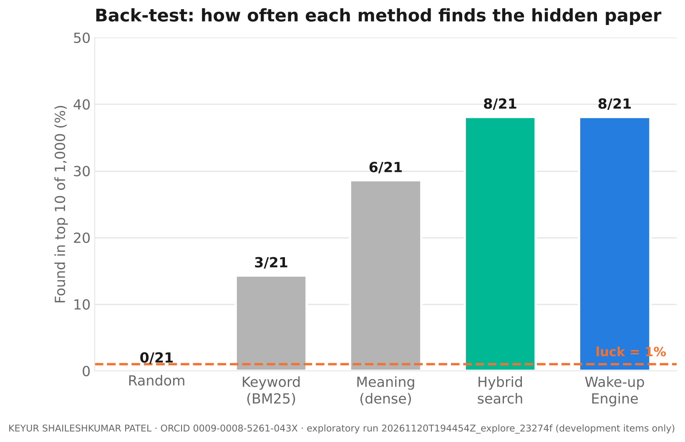
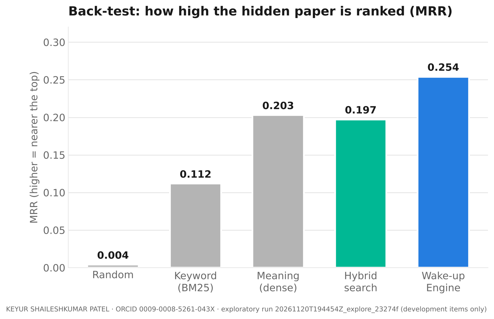
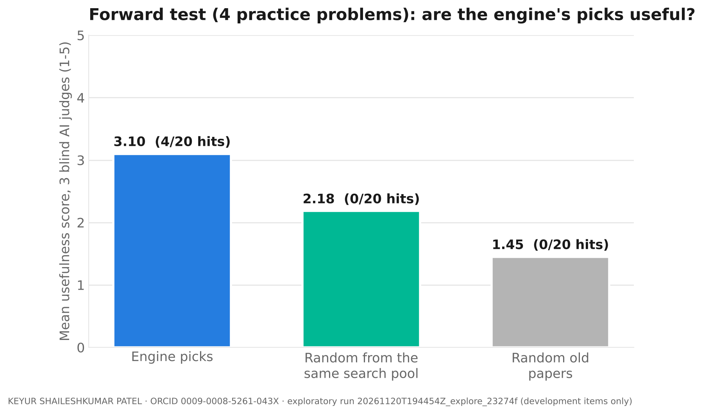
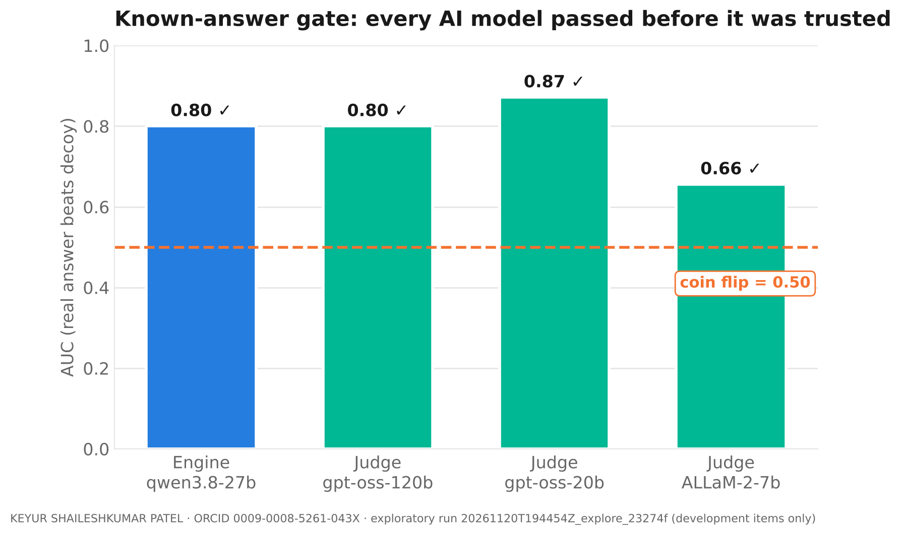

# Wake-up Engine

**Finding forgotten science that already solves today's problems.**

**KEYUR SHAILESHKUMAR PATEL**
ORCID: https://orcid.org/0009-0008-5261-043X
(1) MSc Artificial Intelligence student, Department of Computer Science, Brunel University London, UK
(2) Independent researcher
*Conducted independently; not an official Brunel University London project.*


[](https://doi.org/10.17605/OSF.IO/H948R)


---

Some papers sit unread for decades and then suddenly matter. These are called "sleeping beauties". So far,
people only find them after they wake up. This project tests whether an AI can wake them on purpose.

It runs three preregistered studies, all on a computer, with free data and free open models:

| Study | Question | Main result |
|---|---|---|
| 1. Back-test | Given only what was known the year before a famous sleeping beauty woke up, can the engine pick it out of 1,000 old papers? | Share of sleeping beauties in the engine's top 10, compared with luck (1%) |
| 2. Forward test | For 20 open problems in antibiotic resistance, which forgotten pre-1990 papers might help? | A shortlist of candidates per problem |
| 3. Blind AI panel | Do three different AI judges, who don't know which papers the engine picked, rate the engine's picks higher than random old papers? | Rating difference, hit counts, judge agreement |

## How it works (one picture)



**The back-test, step by step.** For each known sleeping beauty that woke up in year Y:



## Results so far (exploratory, real data, 2026-11-20)

> ⚠️ **These are exploratory numbers from the 21 development papers and 4 practice problems, not findings.**
> The real test runs on the 78 locked papers and the 20 preregistered problems only after OSF registration.

<p align="center"></p>

**Plain reading:** both the Wake-up Engine and plain hybrid search put the hidden paper in their top 10 of 1,000 for 8 of 21 papers (38%), against 1% by luck. On this small sample the engine did **not** beat hybrid search on top-10 hits (a tie, p = 0.75). It did rank the hidden paper higher on average (MRR 0.254 vs 0.197):

<p align="center"></p>

<p align="center"></p>

<p align="center"></p>


First real-data run `runs/20261120T194454Z_explore_23274f` (development part only: 21 sleeping beauties, 4 practice problems; cost $0).
Full report: `runs/WakeUpEngine_Full_Exploratory_Report_2026-11-20.pdf`. These are exploratory numbers, not findings.

| Measure | Result |
|---|---|
| Back-test hit@10, engine | 8 of 21 (38%); luck 1% |
| Back-test hit@10, hybrid search | 8 of 21 (H1b preview: tie, p = 0.75) |
| Engine model recognized the paper | 14 of 21; all engine hits among them (hybrid search shows the same split) |
| Disguised-text check | no loss (4.67 vs 4.44, p = 0.51) |
| Known-answer gate | 4 of 4 models passed (AUC 0.66 to 0.87) |
| Forward test, mean usefulness (1-5) | engine 3.10, random from same search 2.18, random old 1.45 |
| Judge agreement (applicability) | alpha 0.559 |
| Self-checks | 11 of 11 passed |

Open issues found on real data: ISSUES.md I17 to I20. The honest catch: the engine's model "recognized" 14 of 21 papers and all 8 engine hits were among them, but plain search (which has no memory) shows the same split, so recognized papers may simply be easier. The confirmatory study tests this directly (secondary test S1).

Full run folder: `runs/20261120T194454Z_explore_23274f/` (every AI prompt and reply, hashes, logs).

## Why it matters

If the back-test works, it is the first preregistered evidence that AI can wake forgotten science on purpose.
If the forward test finds strong leads, they point labs to old, cheap ideas against antibiotic resistance.
If neither works, the open, preregistered null result shows where AI literature reading falls short.
Details for every outcome: `docs/IMPACT.md`.

## Quick start

You need Python 3.10 or newer.

```bash
# 1. Install (once)
python -m venv .venv
source .venv/bin/activate          # Windows: .venv\Scripts\activate
pip install -r requirements.txt    # exact versions used: requirements.lock

# 2. Offline checks, no keys needed
python -m pytest -q
python run.py selftest             # whole pipeline on synthetic data (about 15 seconds)
python run.py validate             # synthetic worlds with known answers -> validation PDF (about 3 minutes)

# 3. Add your free key
cp .env.example .env               # Windows: copy .env.example .env, then paste GROQ_API_KEY

# 4. EXPLORATORY run on real data: development sleeping beauties (20%) + 4 practice problems
python run.py explore              # -> runs/<id>/WakeUpEngine_Exploratory_Report_<id>.pdf

# 5. Freeze: copy the sample and gate decisions into prereg/ and hash everything. Then register on OSF.
python run.py freeze --from-run runs/<explore run folder>

# 6. CONFIRMATORY run (refuses unless the files match the freeze)
python run.py confirm

# 7. Check any run
python run.py verify runs/<run folder>        # every SHA-256 + the 11 self-checks
python run.py drift-check runs/<run folder>   # re-ask 20 AI calls, compare with the recorded answers
```

`--limit N` makes a small pilot of `explore` (logged as a pilot). It is not allowed for `confirm`.

## Free model options

The study uses only free, open-weights models. You choose where they run in `config/study.yaml`
(edit it **before** `freeze`).

| Option | Cost | Speed | Notes |
|---|---|---|---|
| **Groq** free tier (default) | $0 | fast | Free tiers have daily request and token caps. If a run stops at a cap, run the same command again the next day: every finished call is cached and is not repeated. |
| **OpenRouter** `:free` models | $0 | medium | Low daily limits without credit. |
| **Ollama** on your own computer | $0 | depends on your machine | No limits. Install from https://ollama.com, run `ollama pull llama3.1:8b`, set `provider: ollama` and `model: llama3.1:8b`. |

Rough number of AI calls: exploratory run about 1,600 (about 20 development sleeping beauties x about 80, incl.
gate and disguise checks) + about 400 for the practice problems; confirmatory run about 6,000 back-test + 1,900 forward. Free model names change often. Check your provider's model list and update
`config/study.yaml` before freezing. The judges must not come from the engine's model family, and should come from as many
different families as the provider offers (v0.2 uses two families for three judges; see DECISIONS.md D16).

## Preregistration (OSF)

**Status: registered on OSF on 2026-11-27** - https://osf.io/h948r/ (DOI [10.17605/OSF.IO/H948R](https://doi.org/10.17605/OSF.IO/H948R)).
Freeze 2026-11-27T15:13:50Z, bundle SHA-256 `508bdc28f784e952aabe07a1e628b24bfa6c2f4695e94a103f6e7761313b9a18` (28 files).
One confirmatory item (W1993374508) was excluded before registration (ISSUES I21, DECISIONS D20). Two supporting
files were archived empty on OSF (ISSUES I22); corrected copies are in `prereg/`. Details: `OSF_REGISTRATION.md`.

1. Read and edit `prereg/OSF_preregistration.md` and `config/forward_problems_antibiotic_resistance.yaml`. Every
   choice in them is yours to confirm (record of choices: `DECISIONS.md`).
2. Run `python run.py explore`, read its PDF, then `python run.py freeze --from-run runs/<explore run>`. This copies
   `frozen_sample.json` and `gate_frozen.json` into `prereg/` and writes `prereg/FREEZE_MANIFEST.json` with a SHA-256 hash of every study file,
   all prompts and all analysis code, plus one bundle hash.
3. On https://osf.io create a project, choose the OSF Preregistration template, copy in the sections of the
   document, upload `OSF_preregistration.md`, `FREEZE_MANIFEST.json`, `frozen_sample.json`, `gate_frozen.json`, the
   validation PDF and the exploratory PDF, and paste the bundle hash into section 7.
4. Only then run `python run.py confirm`. Every run re-checks the hashes. If anything changed since the freeze,
   the report and manifest say `DEVIATION_FROM_FREEZE`, and `confirm` refuses to start.

## What every run saves

Each command makes a new folder `runs/<time>_<command>_<id>/`:

```
WakeUpEngine_*_Report_<id>.pdf  easy-language PDF report (exploratory, confirmatory or validation)
checks.json                   the 11 self-checks (C1-C11)
report.md, report.html        readable report with tables, figures, credit and AI-use statement
manifest.json                 author, run info, prereg check, counters, SHA-256 of every file
SHA256SUMS                    same hashes, checkable with `sha256sum -c` or `python run.py verify`
run.log                       full log
config_snapshot.yaml          exact settings used
environment.json              Python, platform, every package version
llm_calls.jsonl               every AI prompt and reply, with hashes
DATA_CARD_results.md          data card for the outputs
data/                         sleeping-beauty screening (beauty coefficient for every candidate)
results/                      ranks, need statements, memorization checks, ratings, statistics (CSV/JSON)
figures/                      PNG figures
```

All OpenAlex and AI responses are also cached in `data/cache/`. Share that folder on OSF so anyone can
re-run the analysis and get the same numbers without new API calls.

## How the engine stays honest

- **No peeking at the future.** In the back-test the need is built only from papers published the year before the
  awakening that do not cite the sleeping beauty.
- **Blinding.** Author names, names used in method names (such as "Freundlich isotherm") and years are removed from
  every paper the AI sees. Judges rate items one at a time, in random order, and never learn which ones the engine
  picked.
- **Memorization check.** The engine model is asked whether it recognizes each anonymized sleeping beauty. The
  main result is repeated without the ones it recognized.
- **Baselines.** Random, BM25 keyword search, dense embeddings and hybrid search are all scored on the same items,
  so we can see whether the AI reading adds anything.
- **The lock.** A fixed SHA-256 rule puts 20% of sleeping beauties in a development part and 80% in a locked part.
  The exploratory run only touches the development part and 4 practice problems; `confirm` only runs after the freeze.
- **Two main tests.** The engine must beat chance (H1a) and beat plain search on the same papers (H1b), so a win
  cannot come from keyword matching alone (synthetic world W4 showed that it can beat chance that way).
- **Known-answer gate.** Every AI model must rank real sleeping beauties above decoys before its scores count. Models
  that give almost every item the same score are dropped (answer collapse).
- **Disguised text.** The top 20 texts are rewritten by a different AI family and re-ranked. A big drop means the AI
  recognized wording, not ideas.
- **Leak scan.** Every text shown to a model is scanned for years, DOIs, links, IDs, author names and study words.
- **Self-checks.** Eleven checks recompute the key numbers a second way (ranks, hits, p-value by simulation,
  judge agreement with a second package) and confirm the lock held.
- **Fixed in advance.** Hit rules, thresholds, prompts and tests are in the config and prompts files and are hashed
  at the freeze.

## Settings you decide

All in `config/study.yaml`. Main ones: sleeping-beauty criteria (sleep at least 10 years, B at least 50, top 100),
1,000 candidates, hit = top 10, re-rank top 50, forgotten = at most 25 citations, judge hit = median applicability
at least 4 with at least 2 of 3 judges and median novelty at least 3, reliability bar Krippendorff's alpha 0.40.

## Project layout

```
run.py                      command line
config/study.yaml           all study settings (preregistered)
config/forward_problems_antibiotic_resistance.yaml   the 20 problems (preregistered)
config/forward_problems_dev.yaml                     4 practice problems (exploratory run only)
prereg/OSF_preregistration.md                        preregistration text
DECISIONS.md, DEVIATIONS.md, ISSUES.md               choices made, changes from plan, known problems
wakeup/                     the engine: OpenAlex client, beauty coefficient, retrieval, AI client,
                            prompts, back-test, forward test, statistics, reports, hashing
tests/                      unit tests and an offline end-to-end test
docs/related_work.md        novelty check
docs/IMPACT.md              what each possible result would mean
docs/figures/               the README charts (made from the run's results files)
```

## Limitations

Today's AI models were trained on text written after these papers woke up, so the back-test is an upper bound.
OpenAlex has fewer abstracts for very old papers. AI judges are not human experts: a forward-test "hit" is a lead
to check, not a confirmed rediscovery. Patents and scanned archives (such as the Biodiversity Heritage Library) are
not included in version 0.2.0.

## How to cite

PATEL, KEYUR SHAILESHKUMAR (2026). *Wake-up Engine: finding forgotten science
that already solves today's problems* (Version 0.2.0) [Software].
ORCID: https://orcid.org/0009-0008-5261-043X

Affiliations: (1) MSc Artificial Intelligence student, Department of Computer
Science, Brunel University London, UK; (2) Independent researcher.
Conducted independently; not an official Brunel University London project.

OSF preregistration: https://doi.org/10.17605/OSF.IO/H948R

Machine-readable citation: `CITATION.cff`.

## AI-use statement

AI assistance: Code and draft text were prepared with help from an AI assistant (Claude, Anthropic) under the
author's direction. All design decisions, hypotheses and hit criteria were chosen by the author. The author takes
full responsibility for the work.

## Licence

Code: MIT (see `LICENSE`). Data, reports and figures produced by runs: CC BY 4.0. OpenAlex data: CC0.
