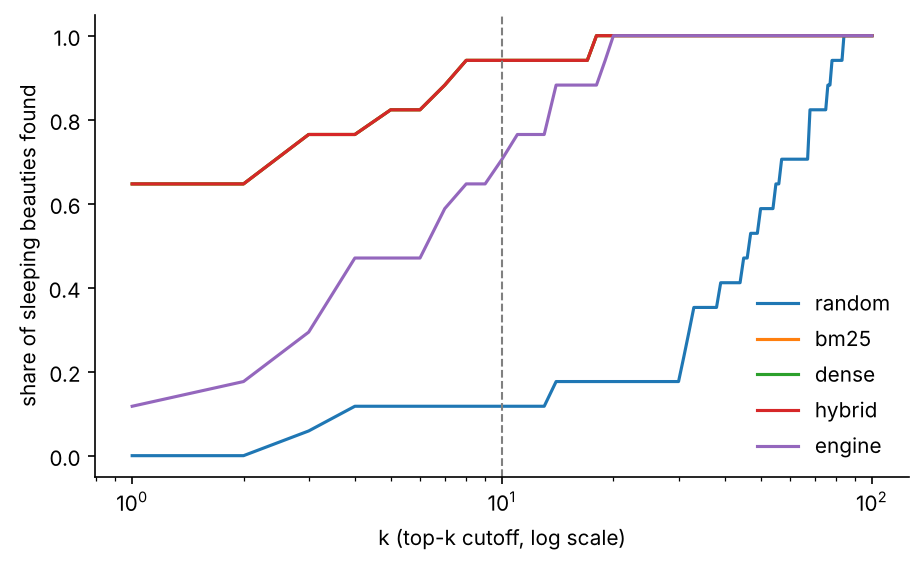
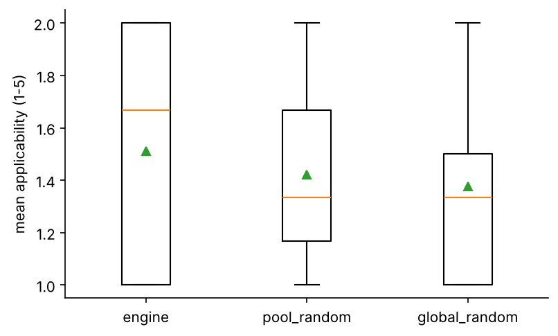

# Wake-up Engine exploratory results (SYNTHETIC DATA)

*Wake-up Engine: A Preregistered Computational Test of Deliberately Waking Science's Sleeping Beauties*

**KEYUR SHAILESHKUMAR PATEL**  
ORCID: https://orcid.org/0009-0008-5261-043X  
(1) MSc Artificial Intelligence student, Department of Computer Science, Brunel University London, UK  
(2) Independent researcher  
*Conducted independently; not an official Brunel University London project.*

Run `20261103T185013Z_selftest_MOCK_7207d4` · software v0.2.0 · started 2026-11-03T18:50:13Z  
Preregistration check: **NOT_FROZEN**

> **MOCK MODE: synthetic data. These numbers are NOT scientific results.**

## Back-test on the development (exploratory) sleeping beauties

- Candidate old papers screened: 810
- Passed sleeping-beauty criteria: 40
- Selected (top by B): 40, of which 21 are in the development (exploratory) part
- Usable after need/decoy checks: 17
- Exclusions: no_awakener_topic: 4

## Main result (H1) - preview only

The engine put the true sleeping beauty in its top 10 for 12 of 17 items (70.6%, 95% CI 46.9% to 86.7%). Chance would give 10.0%. Exact one-sided p = 3.82e-09 (Holm-adjusted 7.63e-09). With 17 items, a true hit rate of 36.4% or more would be detected 80% of the time (minimum detectable effect).

H1b, engine vs plain search on the same items: the engine alone found 0, search alone found 4 (search total 16 of 17). Exact one-sided McNemar p = 1, Holm-adjusted 1.

These items were used to check and tune the method, so this is a preview, not a finding. The preregistered test uses only the locked confirmatory part.

## All methods

| method   |   n |   hit@1 |   hit@5 |   hit@10 |   hit@50 |   hit@100 |     MRR | MRR_95CI       |   median_rank |
|:---------|----:|--------:|--------:|---------:|---------:|----------:|--------:|:---------------|--------------:|
| random   |  17 |  0      |  0.1176 |   0.1176 |   0.5882 |         1 | 0.05534 | [0.022, 0.106] |            47 |
| bm25     |  17 |  0.6471 |  0.8235 |   0.9412 |   1      |         1 | 0.7171  | [0.517, 0.898] |             1 |
| dense    |  17 |  0.6471 |  0.8235 |   0.9412 |   1      |         1 | 0.7171  | [0.517, 0.898] |             1 |
| hybrid   |  17 |  0.6471 |  0.8235 |   0.9412 |   1      |         1 | 0.7171  | [0.517, 0.898] |             1 |
| engine   |  17 |  0.1176 |  0.4706 |   0.7059 |   1      |         1 | 0.2802  | [0.158, 0.426] |             7 |

Pure chance with 100 candidates gives MRR 0.0519 and hit@10 10.0%.

## Does the AI reading add value? (engine vs search alone)

| comparison       |   engine_only_hits |   other_only_hits |   p_exact |   p_holm |
|:-----------------|-------------------:|------------------:|----------:|---------:|
| engine_vs_hybrid |                  0 |                 4 |     0.125 |    0.375 |
| engine_vs_bm25   |                  0 |                 4 |     0.125 |    0.375 |
| engine_vs_dense  |                  0 |                 4 |     0.125 |    0.375 |

## Leakage check 1: did the AI simply remember the paper?

The engine model named 0 of 17 sleeping beauties from their anonymized text (it named 0.0 of decoys, as a comparison).

Without the remembered ones: 12 of 17 hits (70.6%), p = 3.82e-09.

## Leakage check 2: does it still find the paper when the text is disguised?

For the 16 items where the sleeping beauty reached the search top 10, every one of those 10 texts was rewritten by a different AI model and re-ranked. Mean position of the sleeping beauty: 5.1 with original text, 4.5 disguised (one-sided Wilcoxon p = 0.941 for 'worse when disguised'). A large drop would suggest the AI recognizes wording rather than ideas.

## Leakage check 3: prompt leak scan

Every text shown to a model was scanned for years, DOIs, links, IDs, author names and study words. Leaks found: 0.

## Sensitivity: raw abstracts instead of the AI-written need

| method     |   n |   hit@1 |   hit@5 |   hit@10 |   hit@50 |   hit@100 |    MRR | MRR_95CI       |   median_rank |
|:-----------|----:|--------:|--------:|---------:|---------:|----------:|-------:|:---------------|--------------:|
| raw_bm25   |  17 |  0.6471 |  0.8235 |   0.9412 |        1 |         1 | 0.7171 | [0.517, 0.898] |             1 |
| raw_dense  |  17 |  0.6471 |  0.8235 |   0.9412 |        1 |         1 | 0.7171 | [0.517, 0.898] |             1 |
| raw_hybrid |  17 |  0.6471 |  0.8235 |   0.9412 |        1 |         1 | 0.7171 | [0.517, 0.898] |             1 |

*Hit@k for each method; dashed line = preregistered k = 10.*

## Item-level results

| sb      |   sb_year |   awakening_year |      B | field   | waking_topic   |   n_candidates |   rank_random |   rank_bm25 |   rank_dense |   rank_hybrid |   rank_engine | memorized   |
|:--------|----------:|-----------------:|-------:|:--------|:---------------|---------------:|--------------:|------------:|-------------:|--------------:|--------------:|:------------|
| W906244 |      1929 |             1977 | 1488   | B       | mock topic     |            100 |            68 |           1 |            1 |             1 |             4 | False       |
| W902572 |      1954 |             2001 | 1391   | B       | mock topic     |            100 |            55 |           1 |            1 |             1 |             3 | False       |
| W902878 |      1959 |             2005 | 1364   | A       | mock topic     |            100 |            57 |           1 |            1 |             1 |             8 | False       |
| W902266 |      1924 |             1972 | 1293   | C       | mock topic     |            100 |            76 |           8 |            8 |             8 |            14 | False       |
| W906703 |      1921 |             1964 | 1222   | B       | mock topic     |            100 |            78 |           1 |            1 |             1 |             1 | False       |
| W905020 |      1945 |             1985 |  978.8 | C       | mock topic     |            100 |             3 |           1 |            1 |             1 |            20 | False       |
| W907162 |      1915 |             1960 |  961.9 | B       | mock topic     |            100 |            84 |           3 |            3 |             3 |            11 | False       |
| W907315 |      1950 |             1988 |  847.4 | C       | mock topic     |            100 |            68 |           1 |            1 |             1 |             2 | False       |
| W903949 |      1913 |             1960 |  826.1 | B       | mock topic     |            100 |             4 |           7 |            7 |             7 |             7 | False       |
| W901807 |      1940 |             1972 |  681.6 | C       | mock topic     |            100 |            32 |           3 |            3 |             3 |             4 | False       |
| W907009 |      1919 |             1952 |  650.6 | A       | mock topic     |            100 |            45 |           5 |            5 |             5 |            10 | False       |
| W907468 |      1940 |             1967 |  598.1 | A       | mock topic     |            100 |            33 |           1 |            1 |             1 |             3 | False       |
| W903031 |      1937 |             1959 |  511.9 | B       | mock topic     |            100 |            47 |           1 |            1 |             1 |             1 | False       |
| W902419 |      1957 |             1984 |  501.5 | A       | mock topic     |            100 |            14 |           1 |            1 |             1 |            14 | False       |
| W904714 |      1944 |             1974 |  453.6 | A       | mock topic     |            100 |            39 |           1 |            1 |             1 |             7 | False       |
| W904102 |      1935 |             1955 |  420.8 | C       | mock topic     |            100 |            50 |          18 |           18 |            18 |            19 | False       |
| W905785 |      1946 |             1965 |  392.7 | B       | mock topic     |            100 |            31 |           1 |            1 |             1 |             4 | False       |

## Known-answer gate (development items)

| model_name   | role   | provider   | model                    |   n_items |    auc |   p_one_sided |   largest_identical_share |   parse_failure_rate | collapsed   | passed   | reason   |
|:-------------|:-------|:-----------|:-------------------------|----------:|-------:|--------------:|--------------------------:|---------------------:|:------------|:---------|:---------|
| engine       | engine | mock       | mock-engine-signal       |        17 | 0.9118 |      0.000999 |                   0.03922 |                    0 | False       | True     | passed   |
| judge_qwen   | judge  | mock       | mock-judge_qwen-signal   |        17 | 0.6471 |      0.003996 |                   0.8235  |                    0 | False       | True     | passed   |
| judge_gptoss | judge  | mock       | mock-judge_gptoss-signal |        17 | 0.6176 |      0.00999  |                   0.8824  |                    0 | False       | True     | passed   |
| judge_kimi   | judge  | mock       | mock-judge_kimi-signal   |        17 | 0.7    |      0.000999 |                   0.8529  |                    0 | False       | True     | passed   |

## Forward test (exploratory): forgotten pre-1990 candidates for 4 antibiotic-resistance problems

| problem   | title                                             | queries                                                                                                                                                                                                           |   n_retrieved |   n_forgotten |   skipped |
|:----------|:--------------------------------------------------|:------------------------------------------------------------------------------------------------------------------------------------------------------------------------------------------------------------------|--------------:|--------------:|----------:|
| DEV01     | Resistant Helicobacter pylori                     | gastric spiral bacteria treatment | stomach bacteria bismuth | gastric infection non-antibiotic | adjunct antibiotic | cheap clarithromycin | clear eradication | fail infection | makes many                     |            79 |            40 |       nan |
| DEV02     | Drug-resistant typhoid                            | typhoid carrier treatment | enteric fever chronic carriage | gallbladder bacteria elimination | affordable carriage | drug extensively | few leaves | need options | oral prevent                                 |            60 |            34 |       nan |
| DEV03     | Pseudomonas in cystic fibrosis lungs              | mucoid Pseudomonas sputum | airway mucus bacteria penetration | alginate bacteria lung | aeruginosa airway | antibiotics becomes | chronic clear | cystic fibrosis | infection lung                               |            79 |            40 |       nan |
| DEV04     | Replacing growth-promoting antibiotics in farming | livestock growth promotion without antibiotics | gut flora feed additive animals | competitive exclusion poultry | alternatives animal | antibiotic antibiotics | growth health | keep livestock | need practical |             0 |             0 |         1 |

Judges used: judge_gptoss, judge_kimi, judge_qwen. Dropped: none.

Prompt leak scan of the 45 texts shown to judges: 0 leaks found.

## Blind AI judge panel

Judges: judge_gptoss (mock-judge_gptoss-signal), judge_kimi (mock-judge_kimi-signal), judge_qwen (mock-judge_qwen-signal). Each judge saw every item alone, in its own random order, with author names and years removed and without knowing which items the engine picked.

Agreement (Krippendorff's alpha, ordinal): applicability 0.372, novelty -0.047. Applicability alpha is below the preregistered bar of 0.4, so forward-test results are EXPLORATORY only.

| group         |   n_items |   mean_applicability |   mean_novelty |   hits |   hit_rate | hit_rate_95CI   |
|:--------------|----------:|---------------------:|---------------:|-------:|-----------:|:----------------|
| engine        |        15 |                1.511 |          2.8   |      0 |          0 | [0.00, 0.20]    |
| pool_random   |        15 |                1.422 |          2.933 |      0 |          0 | [0.00, 0.20]    |
| global_random |        15 |                1.378 |          3     |      0 |          0 | [0.00, 0.20]    |

## Forward-test hypotheses

H2_engine_vs_pool_random: engine mean 1.51 vs control 1.42 (difference +0.09), stratified permutation p = 0.2517, Holm-adjusted p = 0.2517.

H3_engine_vs_global_random: engine mean 1.51 vs control 1.38 (difference +0.13), stratified permutation p = 0.0989, Holm-adjusted p = 0.1978.

hit_rate_engine_vs_pool_random_fisher: one-sided Fisher exact p = 1.0000.

## Per-judge calibration

| judge        | model                    |   mean_applicability |   mean_novelty |   parse_failures |
|:-------------|:-------------------------|---------------------:|---------------:|-----------------:|
| judge_gptoss | mock-judge_gptoss-signal |                1.378 |          2.844 |                0 |
| judge_kimi   | mock-judge_kimi-signal   |                1.622 |          2.889 |                0 |
| judge_qwen   | mock-judge_qwen-signal   |                1.311 |          3     |                0 |

*Blind judge applicability ratings by group.*

## Rediscovery shortlist (unblinded after rating)

Engine candidates ranked by blind judge rating. A 'hit' here is a lead to check, not a confirmed rediscovery: each needs reading in full and, ideally, a lab or literature follow-up.

| problem   | work_id   | doi   | title                                                              |   year |   cited_by_count |   mean_applicability |   median_novelty | hit   |
|:----------|:----------|:------|:-------------------------------------------------------------------|-------:|-----------------:|---------------------:|-----------------:|:------|
| DEV01     | W900024   |       | method method colony phage obtained phage                          |   1934 |                4 |                2     |                3 | False |
| DEV01     | W900141   |       | experiments antagonism experiments conditions antagonism infection |   1963 |                4 |                2     |                3 | False |
| DEV01     | W900073   |       | mould experiments analysis bacteria phage series                   |   1910 |                6 |                2     |                3 | False |
| DEV01     | W900044   |       | method infection culture strain analysis value                     |   1980 |                2 |                2     |                3 | False |
| DEV01     | W900020   |       | method effect value phage infection bacteria                       |   1913 |                4 |                2     |                3 | False |
| DEV03     | W900141   |       | experiments antagonism experiments conditions antagonism infection |   1963 |                4 |                1.667 |                3 | False |
| DEV03     | W900044   |       | method infection culture strain analysis value                     |   1980 |                2 |                1.667 |                3 | False |
| DEV03     | W900073   |       | mould experiments analysis bacteria phage series                   |   1910 |                6 |                1.667 |                2 | False |
| DEV02     | W900156   |       | study culture analysis series lysis colony                         |   1972 |                6 |                1.333 |                3 | False |
| DEV03     | W900208   |       | analysis serum culture serum results effect                        |   1932 |                4 |                1.333 |                3 | False |
| DEV02     | W900038   |       | bacteria culture antagonism study series study                     |   1965 |                5 |                1     |                3 | False |
| DEV02     | W900125   |       | serum sample antagonism value analysis culture                     |   1942 |                5 |                1     |                2 | False |
| DEV02     | W900073   |       | mould experiments analysis bacteria phage series                   |   1910 |                6 |                1     |                2 | False |
| DEV02     | W900190   |       | found bacteria analysis bacteria observed colony                   |   1966 |                1 |                1     |                3 | False |
| DEV03     | W900012   |       | serum experiments bacteria measurements strain results             |   1967 |                3 |                1     |                3 | False |

## Self-checks

| id   | check                                                     | status   | detail                                                                        |
|:-----|:----------------------------------------------------------|:---------|:------------------------------------------------------------------------------|
| C1   | Every AI reply matches its stored SHA-256                 | pass     | 1497 replies, 0 mismatches                                                    |
| C2   | Judges never see how an item was chosen                   | pass     | 0 judge prompts mention a group label                                         |
| C3   | Ranks recomputed independently from saved scores          | pass     | 17 items recomputed, 0 mismatches                                             |
| C4   | Headline numbers recomputed from the ranks file           | pass     | hits 12 vs 12, MRR 0.2802                                                     |
| C5   | Main p-value recomputed by simulation                     | pass     | exact 3.815e-09, simulated 0                                                  |
| C6   | Lock held: only dev items were processed                  | pass     | 21 processed, 0 from the wrong part                                           |
| C7   | Need built only from the year before waking               | pass     | 17 needs; context year = waking year - 1; citing papers removed at build time |
| C8   | Each candidate set has 1 target and no duplicates         | pass     | 0 problems                                                                    |
| C9   | Prompt leak scan found no clues                           | pass     | 0 leaks                                                                       |
| C10  | Judge agreement recomputed with a second implementation   | pass     | ours 0.372435325602141, reference 0.372435                                    |
| C11  | Known-answer gate decisions follow the preregistered rule | pass     | 4 of 4 models passed                                                          |

## Run notes and deviations

- EXPLORATORY run: development sleeping beauties and practice problems only. Not the preregistered test.
- Embedding fallback to TF-IDF was used (sentence-transformers unavailable).

## Credit, licence and AI use

Author: KEYUR SHAILESHKUMAR PATEL (https://orcid.org/0009-0008-5261-043X). Conducted independently; not an official Brunel University London project.

Data and reports licensed CC BY 4.0. Code licensed MIT.

AI assistance: Code and draft text were prepared with help from an AI assistant (Claude, Anthropic) under the author's direction. All design decisions, hypotheses and hit criteria were chosen by the author. The author takes full responsibility for the work.

Integrity: every file in this run folder is listed with its SHA-256 hash in manifest.json and SHA256SUMS. Check with `python run.py verify <run folder>`.
