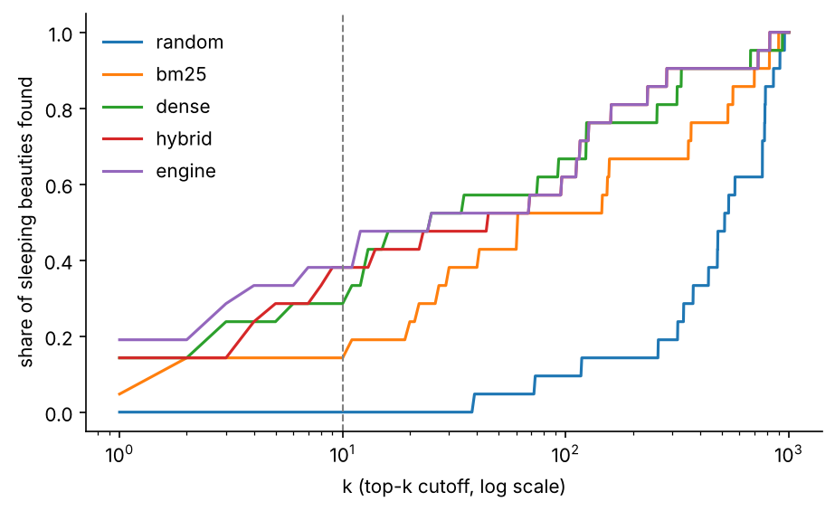
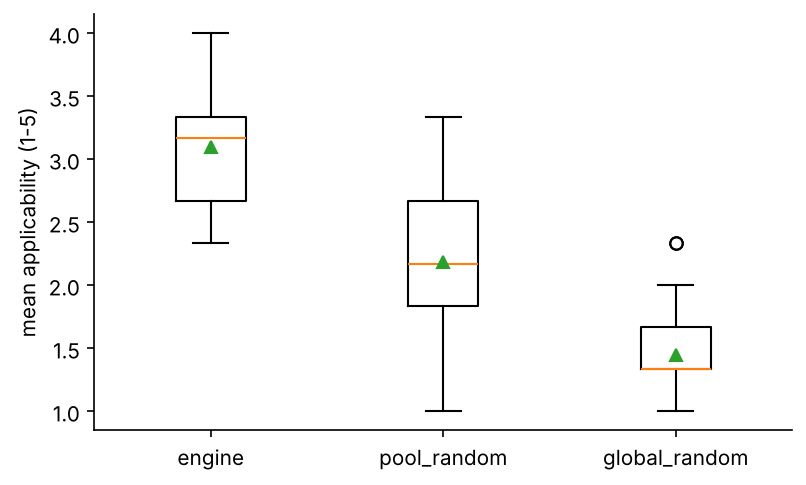

# Wake-up Engine exploratory results

*Wake-up Engine: A Preregistered Computational Test of Deliberately Waking Science's Sleeping Beauties*

**KEYUR SHAILESHKUMAR PATEL**  
ORCID: https://orcid.org/0009-0008-5261-043X  
(1) MSc Artificial Intelligence student, Department of Computer Science, Brunel University London, UK  
(2) Independent researcher  
*Conducted independently; not an official Brunel University London project.*

Run `20261120T194454Z_explore_23274f` · software v0.2.0 · started 2026-11-20T19:44:54Z  
Preregistration check: **NOT_FROZEN**

## Back-test on the development (exploratory) sleeping beauties

- Candidate old papers screened: 6000
- Passed sleeping-beauty criteria: 660
- Selected (top by B): 100, of which 21 are in the development (exploratory) part
- Usable after need/decoy checks: 21
- Exclusions: none

## Main result (H1) - preview only

The engine put the true sleeping beauty in its top 10 for 8 of 21 items (38.1%, 95% CI 20.8% to 59.1%). Chance would give 1.0%. Exact one-sided p = 1.81e-11 (Holm-adjusted 3.62e-11). With 21 items, a true hit rate of 13.6% or more would be detected 80% of the time (minimum detectable effect).

H1b, engine vs plain search on the same items: the engine alone found 1, search alone found 1 (search total 8 of 21). Exact one-sided McNemar p = 0.75, Holm-adjusted 0.75.

These items were used to check and tune the method, so this is a preview, not a finding. The preregistered test uses only the locked confirmatory part.

## All methods

| method   |   n |   hit@1 |   hit@5 |   hit@10 |   hit@50 |   hit@100 |      MRR | MRR_95CI       |   median_rank |
|:---------|----:|--------:|--------:|---------:|---------:|----------:|---------:|:---------------|--------------:|
| random   |  21 | 0       |  0      |   0      |  0.04762 |   0.09524 | 0.003915 | [0.002, 0.007] |           516 |
| bm25     |  21 | 0.04762 |  0.1429 |   0.1429 |  0.4286  |   0.5238  | 0.1117   | [0.021, 0.229] |            61 |
| dense    |  21 | 0.1429  |  0.2381 |   0.2857 |  0.5714  |   0.6667  | 0.203    | [0.072, 0.360] |            25 |
| hybrid   |  21 | 0.1429  |  0.2857 |   0.381  |  0.5238  |   0.619   | 0.1972   | [0.069, 0.353] |            45 |
| engine   |  21 | 0.1905  |  0.3333 |   0.381  |  0.5238  |   0.619   | 0.254    | [0.106, 0.427] |            25 |

Pure chance with 1000 candidates gives MRR 0.0075 and hit@10 1.0%.

## Does the AI reading add value? (engine vs search alone)

| comparison       |   engine_only_hits |   other_only_hits |   p_exact |   p_holm |
|:-----------------|-------------------:|------------------:|----------:|---------:|
| engine_vs_hybrid |                  1 |                 1 |    1      |   1      |
| engine_vs_bm25   |                  5 |                 0 |    0.0625 |   0.1875 |
| engine_vs_dense  |                  2 |                 0 |    0.5    |   1      |

## Leakage check 1: did the AI simply remember the paper?

The engine model named 14 of 21 sleeping beauties from their anonymized text (it named 0.20634920634920634 of decoys, as a comparison).

Without the remembered ones: 0 of 7 hits (0.0%), p = 1.

## Leakage check 2: does it still find the paper when the text is disguised?

For the 9 items where the sleeping beauty reached the search top 20, every one of those 20 texts was rewritten by a different AI model and re-ranked. Mean position of the sleeping beauty: 4.7 with original text, 4.4 disguised (one-sided Wilcoxon p = 0.512 for 'worse when disguised'). A large drop would suggest the AI recognizes wording rather than ideas.

## Leakage check 3: prompt leak scan

Every text shown to a model was scanned for years, DOIs, links, IDs, author names and study words. Leaks found: 0.

## Sensitivity: raw abstracts instead of the AI-written need

| method     |   n |   hit@1 |   hit@5 |   hit@10 |   hit@50 |   hit@100 |    MRR | MRR_95CI       |   median_rank |
|:-----------|----:|--------:|--------:|---------:|---------:|----------:|-------:|:---------------|--------------:|
| raw_bm25   |  21 | 0.09524 |  0.1905 |   0.1905 |   0.4286 |    0.4286 | 0.1471 | [0.034, 0.291] |           116 |
| raw_dense  |  21 | 0.09524 |  0.2381 |   0.381  |   0.5238 |    0.5714 | 0.1682 | [0.058, 0.307] |            21 |
| raw_hybrid |  21 | 0.09524 |  0.3333 |   0.381  |   0.4762 |    0.5238 | 0.1837 | [0.072, 0.323] |            61 |

*Hit@k for each method; dashed line = preregistered k = 10.*

## Item-level results

| sb          |   sb_year |   awakening_year |      B | field                                        | waking_topic                                     |   n_candidates |   rank_random |   rank_bm25 |   rank_dense |   rank_hybrid |   rank_engine | memorized   |
|:------------|----------:|-----------------:|-------:|:---------------------------------------------|:-------------------------------------------------|---------------:|--------------:|------------:|-------------:|--------------:|--------------:|:------------|
| W4210785022 |      1915 |             2018 | 7570   | Medicine                                     | Biographical and Historical Analysis             |           1000 |           260 |         701 |           35 |            96 |            96 | False       |
| W2320303480 |      1973 |             2018 | 3617   | Social Sciences                              | Critical Theory and Philosophy                   |           1000 |           779 |         365 |           93 |           160 |           160 | True        |
| W2300474821 |      1963 |             2004 | 3575   | Environmental Science                        | Adsorption and biosorption for pollutant removal |           1000 |           437 |          61 |            3 |            14 |             3 | True        |
| W1973137999 |      1920 |             2006 | 2901   | Physics and Astronomy                        | Relativity and Gravitational Theory              |           1000 |           538 |          11 |           11 |             9 |             7 | True        |
| W2097680980 |      1923 |             1998 | 2152   | Psychology                                   | Reading and Literacy Development                 |           1000 |           762 |         534 |          936 |           822 |           822 | False       |
| W1980516134 |      1954 |             2007 | 2008   | Computer Science                             | Transportation Planning and Optimization         |           1000 |           786 |         355 |           75 |           127 |           127 | True        |
| W2163272368 |      1951 |             2000 | 1665   | Engineering                                  | Microstructure and mechanical properties         |           1000 |           479 |           1 |            3 |             1 |             1 | True        |
| W1567077956 |      1961 |             2009 | 1191   | Arts and Humanities                          | Poetry Analysis and Criticism                    |           1000 |            73 |          27 |           13 |             5 |             4 | True        |
| W2071736781 |      1979 |             2011 | 1185   | Arts and Humanities                          | Syntax, Semantics, Linguistic Variation          |           1000 |           338 |          30 |           25 |             8 |            12 | False       |
| W1992622896 |      1913 |             2003 | 1051   | Decision Sciences                            | Science Education and Pedagogy                   |           1000 |           574 |         562 |          674 |           729 |           729 | True        |
| W2012721313 |      1929 |             2016 |  920.3 | Environmental Science                        | Remote Sensing in Agriculture                    |           1000 |           913 |          20 |            6 |             4 |             1 | True        |
| W2143370091 |      1934 |             2008 |  849.1 | Earth and Planetary Sciences                 | Geological formations and processes              |           1000 |           118 |          61 |          330 |           112 |           112 | True        |
| W1981366806 |      1923 |             1997 |  784.9 | Chemical Engineering                         | Phase Equilibria and Thermodynamics              |           1000 |            39 |         154 |          316 |           233 |           233 | False       |
| W1980250221 |      1938 |             1996 |  758.4 | Psychology                                   | Traffic and Road Safety                          |           1000 |           318 |          41 |            1 |             4 |             3 | True        |
| W2921739329 |      1981 |             2014 |  644   | Psychology                                   | Language, Discourse, Communication Strategies    |           1000 |           762 |         157 |           13 |            23 |            25 | False       |
| W2323413210 |      1969 |             2018 |  633.9 | Arts and Humanities                          | Language, Discourse, Communication Strategies    |           1000 |           481 |         146 |          124 |           116 |           116 | False       |
| W1999060947 |      1963 |             2015 |  631.5 | Biochemistry, Genetics and Molecular Biology | Geomagnetism and Paleomagnetism Studies          |           1000 |           782 |           2 |            1 |             1 |             1 | True        |
| W1991976434 |      1956 |             2014 |  544.7 | Engineering                                  | Complex Systems and Time Series Analysis         |           1000 |           373 |         819 |          124 |           284 |           284 | False       |
| W2170842367 |      1948 |             2018 |  541   | Physics and Astronomy                        | Quantum Mechanics and Applications               |           1000 |           854 |           2 |            1 |             1 |             1 | True        |
| W2054232302 |      1956 |             2005 |  534.2 | Psychology                                   | Contemporary Sociological Theory and Practice    |           1000 |           957 |          22 |          257 |            45 |            12 | True        |
| W2332131649 |      1969 |             2018 |  514.2 | Earth and Planetary Sciences                 | Geological and Geochemical Analysis              |           1000 |           516 |         901 |           16 |            69 |            69 | True        |

## Known-answer gate (development items)

| model_name      | role   | provider   | model               |   n_items |    auc |   p_one_sided |   largest_identical_share |   parse_failure_rate | collapsed   | passed   | reason   |
|:----------------|:-------|:-----------|:--------------------|----------:|-------:|--------------:|--------------------------:|---------------------:|:------------|:---------|:---------|
| engine          | engine | groq       | qwen/qwen3.8-27b    |        21 | 0.8    |     9.999e-05 |                    0.881  |                0     | False       | True     | passed   |
| judge_gptoss120 | judge  | groq       | openai/gpt-oss-120b |        21 | 0.8    |     9.999e-05 |                    0.7381 |                0     | False       | True     | passed   |
| judge_gptoss20  | judge  | groq       | openai/gpt-oss-20b  |        21 | 0.8714 |     9.999e-05 |                    0.7857 |                0     | False       | True     | passed   |
| judge_allam     | judge  | groq       | allam-2-7b          |        17 | 0.6558 |     0.0177    |                    0.4    |                0.127 | False       | True     | passed   |

## Forward test (exploratory): forgotten pre-1990 candidates for 4 antibiotic-resistance problems

| problem   | title                                             | queries                                                                                                                                                                                                                                                                                      |   n_retrieved |   n_forgotten |
|:----------|:--------------------------------------------------|:---------------------------------------------------------------------------------------------------------------------------------------------------------------------------------------------------------------------------------------------------------------------------------------------|--------------:|--------------:|
| DEV01     | Resistant Helicobacter pylori                     | gastric spiral bacteria treatment | stomach bacteria bismuth | gastric infection non-antibiotic | bacteriocin gastric mucosa | bile salt Helicobacter | probiotic lactobacillus stomach | interferon gastric infection | antimicrobial peptides epithelium                                   |           495 |           357 |
| DEV02     | Drug-resistant typhoid                            | typhoid carrier treatment | enteric fever chronic carriage | gallbladder bacteria elimination | Salmonella typhi chloramphenicol resistance | typhoid carrier state eradication | Salmonella typhi phage typing | typhoid fever vaccine efficacy | Salmonella typhi tetracycline sensitivity |           743 |           562 |
| DEV03     | Pseudomonas in cystic fibrosis lungs              | mucoid Pseudomonas sputum | airway mucus bacteria penetration | alginate bacteria lung | Pseudomonas aeruginosa alginate production | cystic fibrosis sputum viscosity | bacteriophage therapy Pseudomonas | mucolytic enzymes sputum | Pseudomonas biofilm formation                        |           536 |           270 |
| DEV04     | Replacing growth-promoting antibiotics in farming | livestock growth promotion without antibiotics | gut flora feed additive animals | competitive exclusion poultry | antibiotic growth promotion | colistin resistance swine | probiotics animal feed | phage therapy livestock | feed additives performance                                   |           617 |           482 |

Judges used: judge_allam, judge_gptoss120, judge_gptoss20. Dropped: none.

Prompt leak scan of the 60 texts shown to judges: 0 leaks found.

## Blind AI judge panel

Judges: judge_allam (allam-2-7b), judge_gptoss120 (openai/gpt-oss-120b), judge_gptoss20 (openai/gpt-oss-20b). Each judge saw every item alone, in its own random order, with author names and years removed and without knowing which items the engine picked.

Agreement (Krippendorff's alpha, ordinal): applicability 0.559, novelty 0.217. Applicability ratings meet the preregistered reliability bar.

| group         |   n_items |   mean_applicability |   mean_novelty |   hits |   hit_rate | hit_rate_95CI   |
|:--------------|----------:|---------------------:|---------------:|-------:|-----------:|:----------------|
| engine        |        20 |                3.1   |           2.5  |      4 |        0.2 | [0.08, 0.42]    |
| pool_random   |        20 |                2.183 |           1.95 |      0 |        0   | [0.00, 0.16]    |
| global_random |        20 |                1.45  |           1.45 |      0 |        0   | [0.00, 0.16]    |

## Forward-test hypotheses

H2_engine_vs_pool_random: engine mean 3.10 vs control 2.18 (difference +0.92), stratified permutation p = 0.0001, Holm-adjusted p = 0.0002.

H3_engine_vs_global_random: engine mean 3.10 vs control 1.45 (difference +1.65), stratified permutation p = 0.0001, Holm-adjusted p = 0.0002.

hit_rate_engine_vs_pool_random_fisher: one-sided Fisher exact p = 0.0530.

## Per-judge calibration

| judge           | model               |   mean_applicability |   mean_novelty |   parse_failures |
|:----------------|:--------------------|---------------------:|---------------:|-----------------:|
| judge_allam     | allam-2-7b          |                2.712 |          2.305 |                1 |
| judge_gptoss120 | openai/gpt-oss-120b |                2.233 |          1.917 |                0 |
| judge_gptoss20  | openai/gpt-oss-20b  |                1.817 |          2.133 |                0 |

*Blind judge applicability ratings by group.*

## Rediscovery shortlist (unblinded after rating)

Engine candidates ranked by blind judge rating. A 'hit' here is a lead to check, not a confirmed rediscovery: each needs reading in full and, ideally, a lab or literature follow-up.

| problem   | work_id     | doi                                                  | title                                                                                                                                                              |   year |   cited_by_count |   mean_applicability |   median_novelty | hit   |
|:----------|:------------|:-----------------------------------------------------|:-------------------------------------------------------------------------------------------------------------------------------------------------------------------|-------:|-----------------:|---------------------:|-----------------:|:------|
| DEV03     | W2063271730 | https://doi.org/10.1136/adc.58.10.824                | In vitro assessment of combined antibiotic and mucolytic treatment for Pseudomonas aeruginosa infection in cystic fibrosis.                                        |   1983 |               16 |                4     |                3 | True  |
| DEV03     | W2413690924 | nan                                                  | Mucoid and pigmentation characters can be suppressed by non-anti-Pseudomonas aeruginosa antibiotics in cystic fibrosis: a report of promising preliminary results. |   1988 |                2 |                3.667 |                3 | True  |
| DEV03     | W2095737128 | https://doi.org/10.1093/jac/19.5.579                 | Effects of subminimal inhibitory concentrations of antibiotics on the adherence of Pseudomonas aeruginosa to tracheobronchial mucin                                |   1987 |               21 |                3.667 |                3 | True  |
| DEV04     | W4248372034 | https://doi.org/10.1017/s0308229600017785            | Lactobacillus acidophilus fed as a probiotic in the rearing of purchased calves                                                                                    |   1988 |                2 |                3.667 |                3 | True  |
| DEV01     | W2124930046 | https://doi.org/10.1111/j.1348-0421.1977.tb00315.x   | Reduction of Population Levels of Some Indigenous Bacteria by Lactobacilli in the Gastrointestinal Tract of Gnotobiotic Rats                                       |   1977 |               10 |                3.333 |                3 | False |
| DEV01     | W2423067672 | nan                                                  | [Antibacterial treatment of Campylobacter pylori-associated gastritis and peptic ulcer].                                                                           |   1989 |                1 |                3.333 |                2 | False |
| DEV02     | W2169493244 | https://doi.org/10.1111/j.1348-0421.1979.tb00480.x   | Studies on Multiple Drug‐Resistant Salmonella typhi Isolated from Two Independent Patients Treated with Chloramphenicol                                            |   1979 |                2 |                3.333 |                3 | False |
| DEV03     | W2406768580 | nan                                                  | Alginate production by the mucoid Pseudomonas aeruginosa associated with cystic fibrosis.                                                                          |   1987 |                9 |                3.333 |                3 | False |
| DEV03     | W2063872758 | https://doi.org/10.1111/j.1699-0463.1988.tb05305.x   | Bacteriophages in sputum of cystic fibrosis patients as a possible cause of in vivo changes in serotypes of Pseudomonas aeruginosa                                 |   1988 |               23 |                3.333 |                3 | False |
| DEV04     | W2159463070 | https://doi.org/10.4141/cjas79-051                   | FEED ADDITIVES AS GROWTH PROMOTERS FOR LIVESTOCK IN THE UNITED KINGDOM AND IN THE EUROPEAN ECONOMIC COMMUNITY                                                      |   1979 |                0 |                3.333 |                2 | False |
| DEV01     | W2093104032 | https://doi.org/10.3109/00365528609102581            | Potential Hazards of Hypochlorhydria in the Treatment of Peptic Ulcer                                                                                              |   1986 |               10 |                3     |                3 | False |
| DEV02     | W2090973991 | https://doi.org/10.1001/jama.1973.03220200029008     | Typhoid Fever Caused by Chloramphenicol-Resistant Organisms                                                                                                        |   1973 |               19 |                3     |                2 | False |
| DEV02     | W210934606  | nan                                                  | Susceptibility of Salmonella typhi to chloramphenicol, ampicillin and cotrimoxazole.                                                                               |   1980 |                1 |                3     |                3 | False |
| DEV01     | W2031333308 | https://doi.org/10.1136/bmj.299.6707.1093            | Campylobacter pylori, duodenal ulcer disease, and gastrin.                                                                                                         |   1989 |               15 |                2.667 |                2 | False |
| DEV02     | W2149378472 | https://doi.org/10.1093/infdis/129.supplement_2.s219 | Amoxicillin in the Treatment of Typhoid Fever due to Chloramphenicol-resistant Salmonella typhi                                                                    |   1974 |               22 |                2.667 |                3 | False |
| DEV02     | W2411368006 | nan                                                  | Salmonella typhi strain with transmissible multiple resistance.                                                                                                    |   1976 |                1 |                2.667 |                2 | False |
| DEV04     | W2397075543 | nan                                                  | [Occurrence and distribution of antibiotic resistant E. coli strains in faeces from young pigs and calves in Denmark].                                             |   1979 |                2 |                2.667 |                1 | False |
| DEV04     | W2787774908 | nan                                                  | A Study of the Relationship of Antibiotics on Fecal Microflora of Chicks                                                                                           |   1955 |                0 |                2.667 |                2 | False |
| DEV01     | W1967472634 | https://doi.org/10.1111/j.1532-5415.1968.tb02734.x   | TREATMENT OF GERIATRIC PEPTIC ULCER WITH CHYMOTRYPSIN AND AN ANTIBIOTIC                                                                                            |   1968 |               12 |                2.333 |                3 | False |
| DEV04     | W2955583616 | nan                                                  | Effect of Flavomycin on Performance of Growing-Finishing Pigs                                                                                                      |   1972 |                1 |                2.333 |                1 | False |

## Self-checks

| id   | check                                                     | status   | detail                                                                        |
|:-----|:----------------------------------------------------------|:---------|:------------------------------------------------------------------------------|
| C1   | Every AI reply matches its stored SHA-256                 | pass     | 2583 replies, 0 mismatches                                                    |
| C2   | Judges never see how an item was chosen                   | pass     | 0 judge prompts mention a group label                                         |
| C3   | Ranks recomputed independently from saved scores          | pass     | 21 items recomputed, 0 mismatches                                             |
| C4   | Headline numbers recomputed from the ranks file           | pass     | hits 8 vs 8, MRR 0.2540                                                       |
| C5   | Main p-value recomputed by simulation                     | pass     | exact 1.812e-11, simulated 0                                                  |
| C6   | Lock held: only dev items were processed                  | pass     | 21 processed, 0 from the wrong part                                           |
| C7   | Need built only from the year before waking               | pass     | 21 needs; context year = waking year - 1; citing papers removed at build time |
| C8   | Each candidate set has 1 target and no duplicates         | pass     | 0 problems                                                                    |
| C9   | Prompt leak scan found no clues                           | pass     | 0 leaks                                                                       |
| C10  | Judge agreement recomputed with a second implementation   | pass     | ours 0.5585959207250177, reference 0.558596                                   |
| C11  | Known-answer gate decisions follow the preregistered rule | pass     | 4 of 4 models passed                                                          |

## Run notes and deviations

- EXPLORATORY run: development sleeping beauties and practice problems only. Not the preregistered test.

## Credit, licence and AI use

Author: KEYUR SHAILESHKUMAR PATEL (https://orcid.org/0009-0008-5261-043X). Conducted independently; not an official Brunel University London project.

Data and reports licensed CC BY 4.0. Code licensed MIT.

AI assistance: Code and draft text were prepared with help from an AI assistant (Claude, Anthropic) under the author's direction. All design decisions, hypotheses and hit criteria were chosen by the author. The author takes full responsibility for the work.

Integrity: every file in this run folder is listed with its SHA-256 hash in manifest.json and SHA256SUMS. Check with `python run.py verify <run folder>`.
